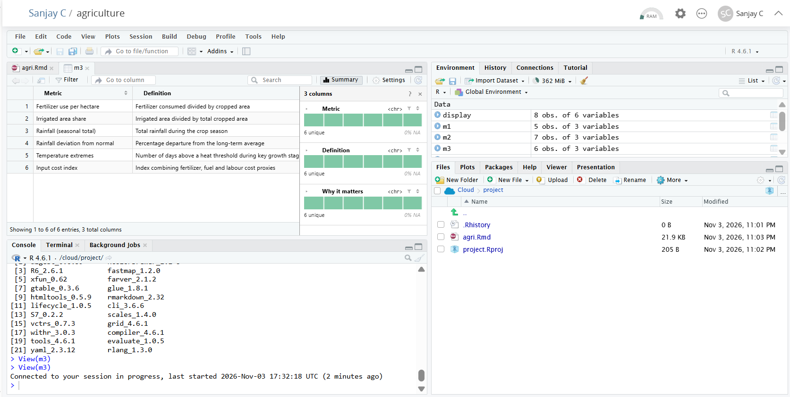

# 🌾 Agribusiness Data Analysis Planning

> A structured, reproducible plan for collecting and analyzing public agribusiness data to forecast agriculture market trends.


---

## 📌 Overview

Agricultural data is freely available but scattered across many agencies, formats and quality levels. This project designs a plan to bring that data together and turn it into insight about **crop yields, price dynamics and resource use**, so that market trends can be forecast.

The report is a **planning document**. It explains the research rationale, selects data sources, defines key metrics, sets out a step-by-step analysis workflow and gives a realistic timeline.

## 🎯 Objectives

- Identify reliable public data sources on agriculture market trends
- Define key indicators for yield, pricing and resource utilization
- Design a repeatable workflow for collection, cleaning, analysis and interpretation
- Build a timeline with clear milestones
- Show how the results can support real agribusiness decisions

## 📁 Project Structure

| File | Description |
|:-----|:------------|
| `agri_analysis_plan.Rmd` | R Markdown source of the report |
| `agri_analysis_plan.docx` | Knitted Word report (the submitted file) |
| `workflow.png` | Screenshot of the project in RStudio (Posit Cloud) |

## 📊 Data Sources Planned

| Source | Data |
|:-------|:-----|
| FAOSTAT | Production, yield, area, trade |
| DES, Ministry of Agriculture (India) | State and district crop statistics, MSP |
| Agmarknet (data.gov.in) | Daily mandi prices and arrivals |
| USDA (PSD, NASS) | Global supply and demand balances |
| World Bank | Commodity prices, development indicators |
| IMD | Rainfall and temperature |
| NASA POWER / Open-Meteo | Gridded daily weather |
| FAO / Fertiliser Association of India | Fertilizer use and prices |

## 📐 Key Metrics

- **Crop production:** yield, area harvested, production, yield growth, yield variability
- **Pricing dynamics:** modal price, price spread, month-on-month change, seasonal index, volatility, price-to-MSP ratio, arrivals
- **Resource utilization:** fertilizer use per hectare, irrigated area share, seasonal rainfall, rainfall deviation, temperature extremes, input cost index

## 🔄 Analysis Workflow

1. **Define and scope:** crops, regions, years, forecasting target
2. **Collect data:** bulk downloads and APIs, raw files kept unchanged
3. **Clean and prepare:** standardize units, handle missing values, detect outliers, merge tables
4. **Explore:** summary statistics, trends, seasonality, correlations
5. **Model and forecast:** naive baseline, regression, ETS and ARIMA, validated with MAE, RMSE and MAPE
6. **Interpret and communicate:** plain-language findings, prediction intervals, recommendations

## 🗓️ Timeline

A 20-working-day plan in 8 phases:

| Phase | Days |
|:------|:-----|
| Scope and setup | 1 to 2 |
| Source identification | 2 to 4 |
| Data collection | 4 to 7 |
| Cleaning and merging | 7 to 11 |
| Exploration | 11 to 14 |
| Modelling and forecasting | 14 to 17 |
| Interpretation and report | 17 to 19 |
| Buffer, review, submission | 19 to 20 |

## ✅ Results (Deliverables of the Planning Phase)

This is a planning task, so the results are the completed plan components:

- 8 public data sources identified and compared, with 5 evaluation criteria
- 3 groups of metrics defined (production, pricing, resource utilization)
- A 6-stage workflow with R code examples for collection and cleaning
- A 20-day timeline with milestones and a Gantt-style chart
- 6 risks identified, each with a mitigation
- Expected outcomes for farmers, traders, policy makers and lenders

## ⚠️ Limitations

- Public data can be delayed, revised or aggregated
- Mandi prices may differ from what farmers actually receive
- Statistical relationships do not prove cause and effect
- Forecasts weaken over long horizons and during shocks such as policy changes or extreme weather

## 🚀 How to Reproduce

1. Open `agribusiness_data_analysis_plan.Rmd` in RStudio or Posit Cloud
2. Install the packages:
   ```r
   install.packages(c("rmarkdown", "knitr", "ggplot2"))
   ```
3. Click **Knit to Word**

## 🔭 Next Steps

Carry out Stage 1 (scoping), start the source evaluation, then collect and clean the data to begin the analysis phase.

## 🖼️ Grab



*Project running in RStudio on Posit Cloud, showing the Rmd file, data objects and knitted output.*
